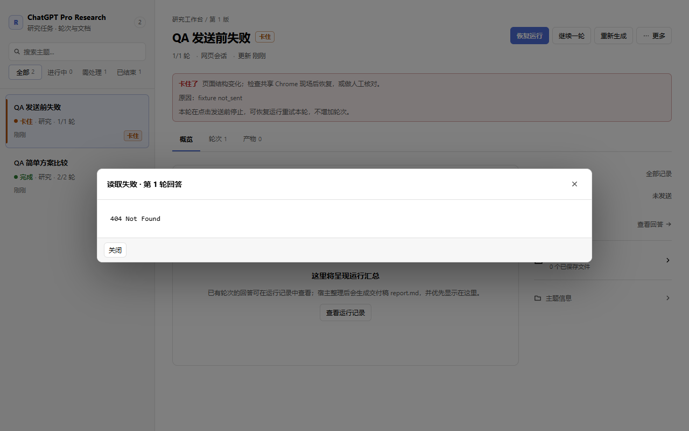
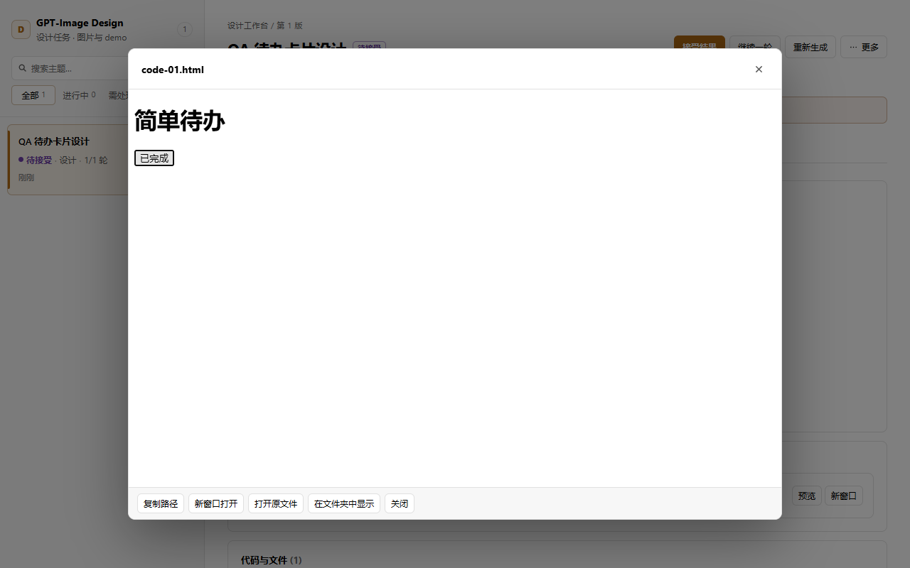
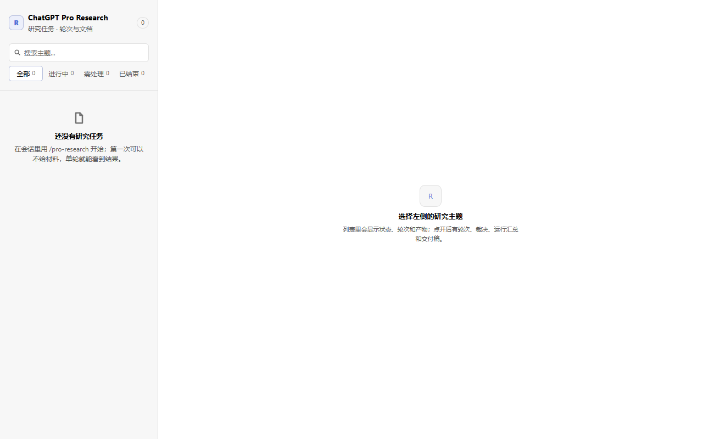
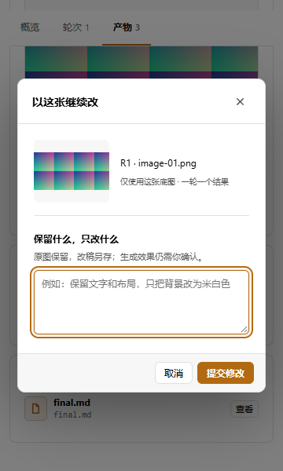

# 两个 DSH 插件：流程、可靠性、界面与恢复测试

日期：2026-10-28（Asia/Shanghai）。候选：两个插件本机 **0.3.3**，Git HEAD `e654f35cc304fd8787f739a57c5aa02f3d93f75c` 加开始测试时已有的未提交修复。系统：Windows；测试进程 Node `v24.22.1`，本机 Google Chrome。

本文件记录第一阶段基线：当时模拟调用的主要功能与恢复检查通过，发现两处界面问题。**两处问题现已修复并复测；真实网页及恢复测试见[后续验收记录](harness-web-2026-10-28.md)。** 下文的“尚未修复”和“没有真实调用”描述保留为当时的历史证据，不能代表最新状态。付费生图 API 未验收。

## 范围与方法

- 完整运行现有单元、服务集成、真实 Chrome 本地网页夹具测试，以及类型检查、构建和 bundle smoke。
- 新增 `scripts/acceptance-smoke.mjs`。它在新的 `.tmp` 数据目录、独立 Node 子进程中加载两个实际构建 bundle，通过真实 Cordis 注册工具和 HTTP 路由。浏览器加载实际前端 bundle，共享 React；替代的只是 ChatGPT、裁决模型和生图服务。
- Research 使用“比较文本清单与看板，给出两个选项、取舍表、未决问题”；Design 使用“一张待办卡片图、一个带完成按钮的 HTML demo”。图片为可解码的确定性 PNG 夹具，不用于评估生成质量。
- 首次使用从空记录和未登录夹具状态开始。恢复测试强制终止测试宿主进程，再从同一磁盘目录启动新宿主，核对调用日志中的实际提交次数。
- 使用 Windows computer-use 检查运行中的 DSH：两个面板入口、既有研究失败状态与人工核对入口、历史设计画廊、指定底图续改弹窗、Escape 关闭普通续改弹窗。未操作旧主题的恢复、接受、重新生成或删除。
- 四个构建 bundle 的 SHA-256 与本机 desktop profile 已安装的 0.3.3 文件完全一致。没有重新安装、重启日常 DSH 或修改其配置。

## 结果

| 检查 | 结果与证据 |
|---|---|
| `npm test` | 180 passed / 12 skipped；跳过项为可选 Chrome 用例 |
| 显式开启 Chrome 用例 | `DSH_PRO_TRANSPORT_SMOKE=1` 下 `transport.smoke.test.ts` + `page-state.test.ts`，12/12 passed |
| 类型、构建、bundle | 全通过；每个插件 1 工具、9 路由、2 前端槽位 |
| 新增验收脚本 | 10 组主流程检查通过；2 个 UI finding 单独记录，不能把脚本退出码 0 理解成零缺陷 |
| 首次使用 | 两个空面板有开始指引；未登录 probe 返回失败；缺少 confirmed 的调用被阻止、提交计数为 0；模拟登录后两插件共享可用状态 |
| Research 闭环 | 工具调用→一次提交→答复落盘→逐条判据裁决→运行汇总 `final.md`；local 存储路径与返回值一致 |
| Research 续轮 | 空输入被面板阻止；填入补充问题后只增加 1 轮、1 次发送 |
| Design 网页通道 | 保存 PNG 与 HTML；图片能解码；预览中“完成任务”按钮变为“已完成”；文本裁决通过后仍保持待人工确认视觉效果 |
| Design 指定底图 | 弹窗预览与文件对应；续改记录正确保存 baseArtifact，只发起 1 次新提交 |
| 网页任务宿主重启 | waiting 任务 reattach 原提交并完成；提交总数不变。已完成的研究、设计两轮历史以及待裁决记录保留 |
| 明确未发送 | 重启后保持 stalled，不自动重发；显式 resume 重试同一轮，轮数仍为 1、尝试数增加一次 |
| 提交结果不明 | 普通 resume 被拒绝；核对为“未提交”后才重试；不盲目重放 |
| 裁决失败 | 停在 reviewing；重启不丢失答复；恢复只裁决保存答案，提交数始终为 1 |
| 取消 | waiting 任务可取消，落盘状态 cancelled，没有额外提交 |
| API 通道 | 实际 HTTP 请求发到本地假服务；首次生图只产图片；指定底图进入 `/images/edits`，请求包含选定图片的字节；404 停在 stalled |
| API 进程重启 | 丢失的在途请求进入 stalled；启动恢复与普通 resume 均无新增 API 请求；明确 regenerate 后仅增加 1 次请求并成功 |
| 浏览器恢复及布局 | 页面重新加载后记录可见；搜索无结果状态正常；浅/深主题，360/520/1280 × 600 检查无整页横向溢出；窄屏通过列表进入详情；续改弹窗提交按钮均可达 |
| 浏览器运行错误 | 主流程没有 pageerror；无答复入口问题的 404 为单独记录的预期复现结果 |

## 尚未修复的问题

### UI-01：无答复时概览仍能打开“查看回答”

复现：在提交前注入 `not_sent` 失败 → 打开 Research 主题的概览 → 点击“最近活动 / 查看回答”。该轮没有答复，界面却打开“读取失败 · 第 1 轮回答”，内容为 `404 Not Found`。切到轮次页，同一轮的“查看回答”已正确禁用。

影响：错误状态下的操作不一致，容易让用户误以为答复丢失。未观察到数据破坏或重复提交。共享组件 `Rail` 中该按钮未判断 `answeredAt`；轮次表已经有相关判断。

建议：复用轮次表的答复可用性判断，在概览中禁用或隐藏无答复入口。测试阶段仅记录，没有修改候选产品代码。



### UI-02：HTML demo 获得焦点后 Escape 无法退出预览

复现：Design → 产物 → HTML“预览” → 点击 iframe 内的“完成任务” → 按 Escape。demo 交互成功，但预览仍然打开；右上角或底部“关闭”按钮可以关闭。

影响：键盘退出体验不一致，属于非阻断问题。普通续改弹窗的 Escape 测试正常。复现于本机 Chrome 加载实际前端 bundle 的隔离环境；未单独重现于 DSH 原生窗口内的 HTML iframe。

建议：明确处理 iframe 焦点下的退出交互；不要为获取键盘事件而放宽产物 iframe 的隔离设置。



## 重跑与证据

```powershell
npm test
npm run typecheck
npm run build
node scripts/smoke-bundle.mjs
$env:DSH_PRO_TRANSPORT_SMOKE='1'
npx vitest run packages/transport/test/transport.smoke.test.ts packages/transport/test/page-state.test.ts
Remove-Item Env:DSH_PRO_TRANSPORT_SMOKE
node scripts/acceptance-smoke.mjs
```

新增脚本需要已安装 Chrome。每次运行创建独立 `.tmp/acceptance-20261028/run-*`，保留 `result.json`、`calls.ndjson`、本地主题记录与截图。脚本关闭自己启动的浏览器和测试宿主，不读取真实登录资料，不调用付费服务。

本次完整通过的原始证据：`.tmp/acceptance-20261028/run-n9k0IP/`；其中 `api/` 是独立 API 数据根。此前脚本调试运行保留在相邻目录，不作为通过证据。常用截图已复制到本文同名目录，均只包含模拟任务。





## 验收边界

- 本轮没有新增真实 ChatGPT 提交、真实账号登录、真实付费生图调用或图片质量评估。浏览器夹具通过不等于真实站点 DOM、模型选择和风控流程通过。
- 空数据与进程恢复通过来自真实 bundle 的隔离宿主；不等同于重新安装一个完整 DSH desktop profile。原生窗口检查属于既有安装的使用验证。
- 模拟裁决服务验证插件流程，没有调用真实 DSH 模型完成自然语言技能路由或宿主交付稿编写；`report.md` 由宿主整理，不是本次夹具产生的交付。
- 未开展 macOS、Linux、长期稳定性、所有网络中断或所有图像服务商兼容性测试。
- 本轮仅新增验收脚本、报告与无敏感信息的截图；保留原有未提交修复，没有提交、推送或发布。
