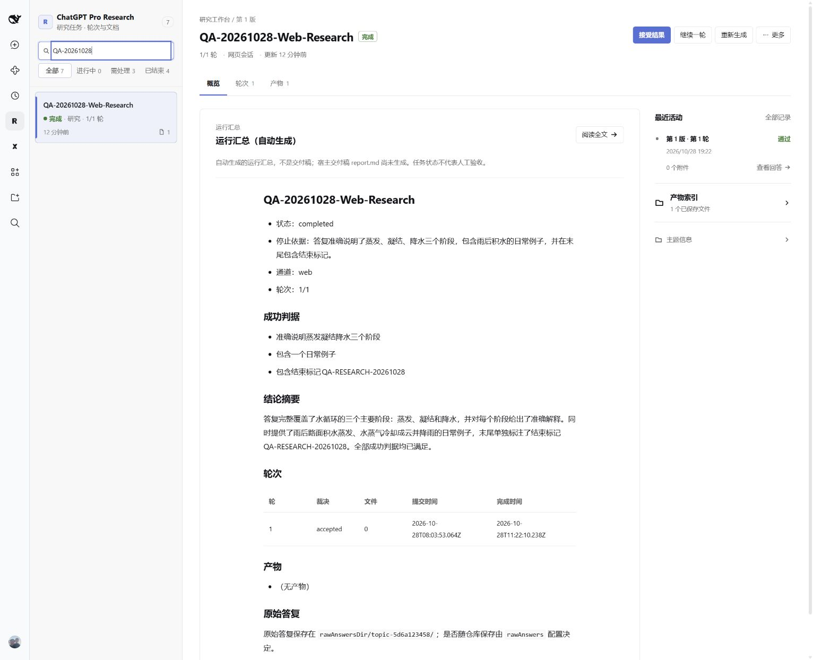
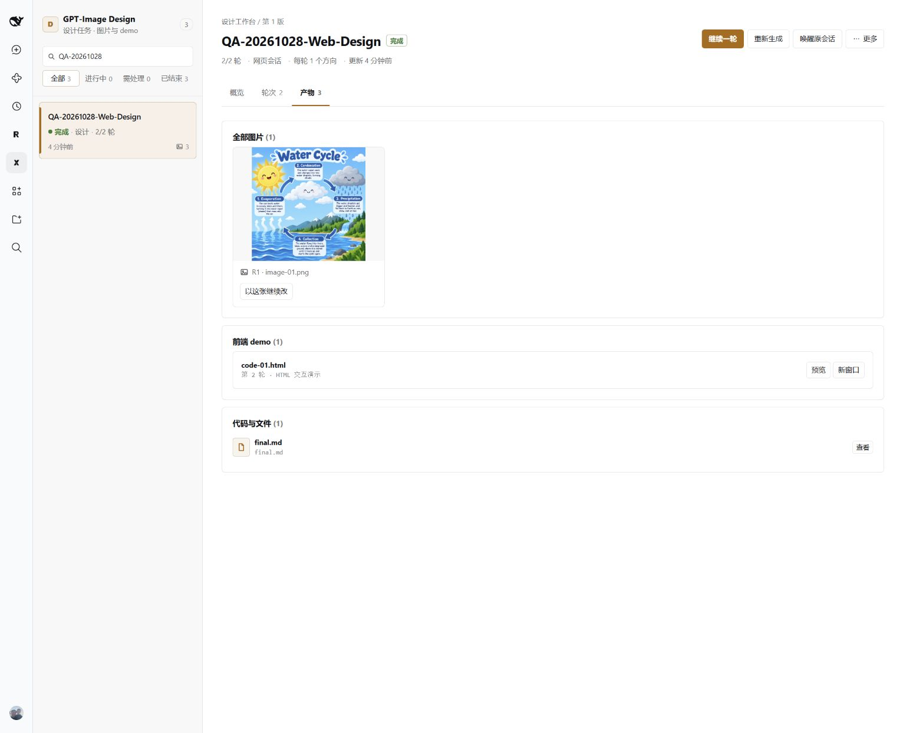
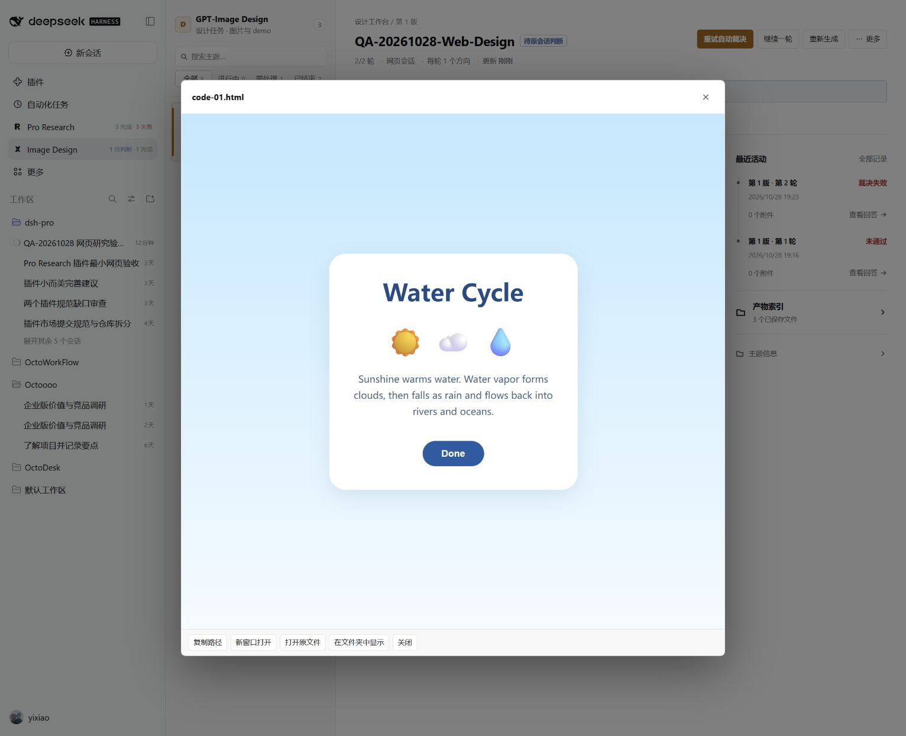
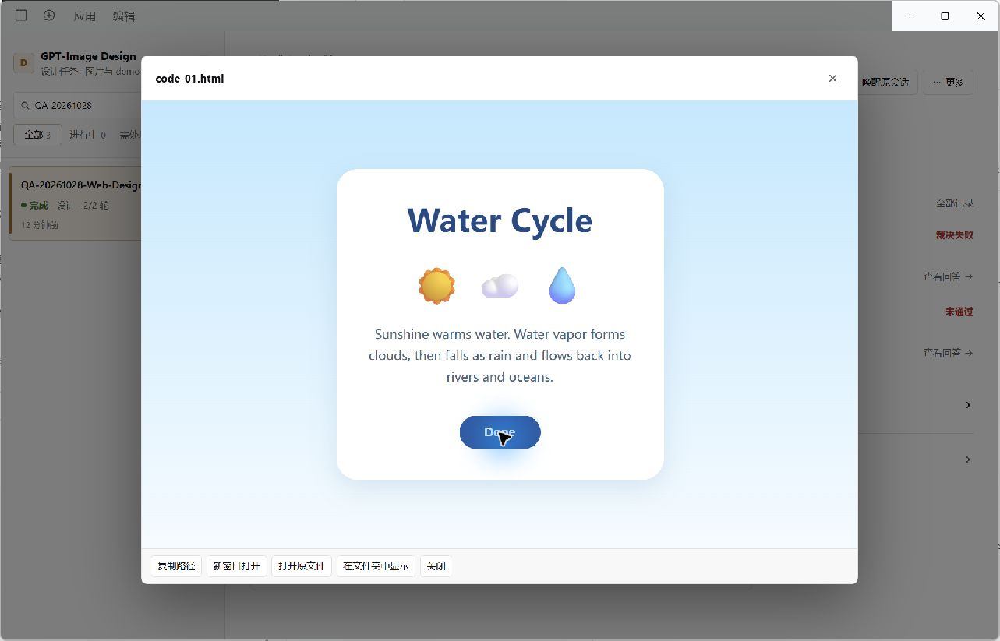

# 两个插件：UI 修复与真实 ChatGPT 网页验收

日期：2026-10-28，Windows，候选版本 0.3.3（本地未发布）。在原有未提交修改之上修复，未提交、推送、发布或修改生成的分发仓库。

**结论：两处 UI 缺陷修复通过；真实研究、真实图片/HTML 获取及中断恢复已验证。尚不能宣布完整验收通过：全新浏览器首次登录未完成，设计自动裁决出现 JSON 错误，宿主交付稿落盘受到其工作区权限限制。** 主题状态 completed 不等于所有验收项目通过。

## 环境与边界

- 实际安装的 DeepSeek Harness 官方 CLI，以独立 `web-acceptance-20261028` profile 运行实际插件及实际前端；通过 DSH 自然语言会话调用两个工具，使用真实 ChatGPT 网页账号。不是模拟宿主截图。
- 使用官方 Chrome 扩展连接用户主 Chrome，核对同一 ChatGPT 会话的页面。插件自己的持久浏览器负责提交与取回；主 Chrome 负责独立观察，没有复制登录资料。
- 本轮实际网页任务没有上传本地材料。没有调用付费生图 API；既有回归脚本的 API 用例仅访问本地假服务。DSH 宿主模型用于路由和裁决，与生图 API 验收区分。
- 修复 bundle 已通过本地 tarball 安装到 desktop 与 QA profile。两个 profile 的四个 bundle 均与当前源码构建产物 SHA-256 一致，见 [evidence.json](harness-web-2026-10-28/evidence.json)。
- 原生桌面进程曾为重新加载插件停止，主要端到端验收运行于官方 Web UI。收尾已停止 QA Web 宿主、恢复日常 DSH 原生桌面窗口，并在原生插件预览中补测真实 HTML 的 Start → Done 与 iframe 内 Esc 退出。

## 修复与回归

| 问题 | 修复与验证 |
|---|---|
| 无答复时概览仍能打开“查看回答”，产生 404 | 概览按 `answeredAt` 禁用入口，与轮次页一致。自动浏览器验收断言按钮禁用。 |
| HTML iframe 获得焦点后 Esc 不能退出预览 | 仅嵌入预览 HTML 注入 Esc 通知；父页验证消息来自当前 iframe。保持 sandbox 隔离，原始/下载文件不变。模拟用例和真实 HTML 都验证关闭及焦点恢复；伪造来源消息不能关闭。 |
| 当前 ChatGPT 页面完成状态与消息结构不匹配 | 支持 `data-talvt-turn-state` 轮次、当前用户气泡、纯生图 gallery 及“复制图像”工具栏；避免把代码区或用户消息的复制按钮误认成完成。 |
| 生图答复取到了“编辑”按钮文字 | 图片 gallery 作为可完成的答复节点，但排除其 Edit 界面文字。保存的图片列表传给裁决模型，提醒“文件存在不代表视觉或交互通过”。 |
| Markdown 问题恢复时无法匹配原提交 | 发送确认与恢复匹配对问题及页面用户文本使用一致的规范化规则；新增完成后重新关联原问题的 Chrome 回归。 |

修复后检查：

- `npm test`：180 passed，14 skipped（可选 Chrome 用例另行运行）。
- 显式 Chrome：`page-state.test.ts` + `transport.smoke.test.ts`，14/14 passed。
- `npm run typecheck`、`npm run build`、`node scripts/smoke-bundle.mjs` 通过。
- `node scripts/acceptance-smoke.mjs`：10 组检查通过，`findings=[]`、`errors=[]`。证据 `.tmp/acceptance-20261028/run-mtovVg/`；包含空面板、未登录夹具、确认保护、裁决失败恢复、不明提交不重放、取消、响应式与预览交互。它们仍是确定性模拟测试，不替代真实首次登录。
- `git diff --check` 通过。

## 真实研究及恢复

主题 `QA-20261028-Web-Research` / `topic-5d6a123458`。

[ChatGPT 会话](https://chatgpt.com/c/6ae1ac62-0870-83ea-96a6-ae1b438b426d)。任务：约 200 字说明蒸发、凝结、降水，给日常例子并输出验收标记。

原候选未能识别当前页面已完成的答复，等待后进入 stalled。修复页面识别与问题匹配后，显式恢复同一轮，19:22 取回答复并自动裁决 accepted → completed。真实正文包含三个阶段、雨后积水例子及 `QA-RESEARCH-20261028`。

恢复后浏览器只有 **1 条用户消息**；round 1 的 attempts=1、原始 submittedAt 保持不变。没有重新发送问题。

## 真实绘图、HTML 及强制中断恢复

主题 `QA-20261028-Web-Design` / `topic-578d47e0f2`。

[ChatGPT 会话](https://chatgpt.com/c/6ae1d87e-3664-83e9-b8ae-bbce492c5351)。第一轮要求水循环学习卡与 HTML，ChatGPT 实际只生成图片；没有把未返回的 HTML 计为成功。随后明确追加一轮，只补 HTML，不再生图。

1. 第一轮在网页图片生成期间停止测试宿主，启动后重新关联原提交，保存实际 PNG。
2. 第二轮于 19:22:54 记录 submitted/waiting 后强制停止测试宿主。重启自动关联原提交，19:23:22 保存完整 HTML。
3. 对比中断前快照与最终记录：两轮 attempts 均为 1，提交时间与 fingerprint 保持一致；重新关联的本地 submissionId 可以变化。网页最终 **2 条用户消息、1 个图片 gallery**，没有恢复引起的重复发送。
4. 实际 HTML 在插件预览里点击 Start → Done，按钮禁用；iframe 焦点下 Esc 关闭预览，焦点回到“预览”。
5. 第二轮自动裁决失败并保留为 reviewing；点击重试只使用已保存答案，没有新增网页消息。宿主随后核对产物并执行 accept，主题 completed，历史裁决错误仍保留。

产物与可复核证据：

- [原始生成 PNG](harness-web-2026-10-28/water-cycle.png)：1,848,139 字节，**1254×1254**，目视包含 Water Cycle、太阳、云、雨、循环箭头。brief 的 1024×1024 未严格实现，不能宣称精确尺寸验收通过；没有改图或用截图替换。
- [原始 HTML](harness-web-2026-10-28/water-cycle.html)：1,515 字节，单文件内联 CSS/JS，无外部资源。
- [事件、轮次与 SHA-256](harness-web-2026-10-28/evidence.json)。中断前原始快照保存在 `.tmp/web-acceptance-20261028/design-before-restart.json` 和 `design-round2-before-interruption.json`。

## 未关闭的验收项

### 首次真实登录

已用独立空 `DSH_HOME`（`C:\Users\satan\.dsh\qa-web-first-use-20261028`）加载两个真实 bundle 和真实网页传输，未替换传输、未复制主浏览器 cookies。该环节使用真实 Cordis 最小测试宿主，不能等同于全新官方 DSH 安装验收。

首次 probe 返回 `ok=false / loggedIn=false`，原因是找不到 composer；这只证明未就绪，不能单凭它区分登录页、页面未加载或站点挑战。调用 login 打开新窗口等待人工登录，两次均 5 分钟超时，未取得登录成功回执；没有发送新任务。因此新账号会话的两个短任务与跨插件复用登录状态均未标通过。原有持久 profile 的恢复使用已经通过。

首次使用辅助脚本清理时暴露 `ctx.dispose is not a function`，已改为当前 Cordis 的 `ctx.fiber.dispose()` 并验证空 Context 可正常清理。它是 QA 辅助脚本问题，不能记作插件缺陷；登录成功路径仍需要实际执行。检查没有遗留该独立测试 profile 的 Chrome 进程。

### 设计自动裁决

第二轮两次裁决周期都出现 `judge returned no JSON object`（每个周期包含引擎的内部重试）。错误后答案、PNG、HTML 没有丢失，停在 reviewing，人工核对/accept 流程可用。

目前没有保存模型原始流或结束原因，**不能把原因直接断言为模型配置、token 限制或服务故障**。该项仍待诊断；人工接受不代表自动裁决修复。已有产物列表传入裁决也不能保证模型总会返回合规 JSON。

### 宿主交付稿

研究 `final.md` 为插件运行汇总，不能替代技能要求的宿主 `report.md`；设计同理需要宿主 `design.md`。实际 DSH 会话处于 workspace-write，向 local 存储的 `~/.dsh/...` 写交付稿被它自己的文件权限拒绝。没有更改安全设置或替该宿主绕过拒绝；这两份宿主交付稿仍未落盘，面板明确显示其缺失。

后续应在正式产品流程中解决授权写入范围或交付位置，再复测“答复→裁决→宿主交付稿→面板显示”的最后一步。本报告及 QA 产物副本位于当前项目工作区，属于验收证据，不冒充宿主交付稿。

## 下一次继续的位置

保留现有两个 completed 主题，不为补验收重复运行它们。完成新测试窗口的人工登录后继续首次使用脚本；对裁决原始流增加有限诊断后复现 JSON 错误；在明确允许的交付路径完成宿主交付稿并检查面板。付费 API、macOS、Linux、长期稳定性以及未实际执行的上传材料流程仍不在本轮通过范围内。
